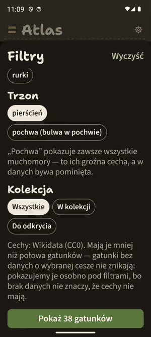

# Grzybodex

Mobilny atlas i skaner polskich grzybów (React Native + Expo): atlas gatunków, rozpoznawanie ze zdjęcia na urządzeniu, ostrzeżenia o trujących sobowtórach, mapa miejscówek offline i prywatny rejestr zbiorów. Aplikacja działa bez konta i bez serwera.

> **Aplikacja nie zastępuje grzyboznawcy.** Wynik skanera to podpowiedź, nie wyrok. Nie jedz grzyba tylko na podstawie rozpoznania z telefonu.



*Nagranie z emulatora Androida (dev build): filtr cech, karta gatunku, ekran „Jak odróżnić”. Wersja w lepszej jakości: [docs/media/demo.mp4](docs/media/demo.mp4).*

## Co potrafi

| Funkcja | Opis |
|---|---|
| **Atlas** (400 gatunków) | Kategorie: jadalny / niejadalny / trujący / śmiertelnie trujący (wg wykazu Ministra Zdrowia i podanych źródeł). Szukanie, filtry kategorii i cech (spód kapelusza, trzon), zdjęcia i opisy PL/EN. |
| **Skaner** | Do 3 ujęć grzyba, rozpoznanie modelem ViT działającym w telefonie (offline). Top-3 z podobieństwem, ramka „może nie być w katalogu” poniżej p = 0,9 i przycisk „Zgłoś grzyba” (e-mail, zdjęcia bez EXIF). |
| **Alerty o trujących** | Ostrzeżenie, gdy: (1) trujący gatunek jest w top-3, (2) w top-3 jest groźny rodzaj (np. *Amanita*), (3) tabela sobowtórów wskazuje groźny gatunek podobny do wyniku. |
| **Jak odróżnić** | Ekran porównania sobowtórów (`/porownaj`): cechy obok siebie z Wikipedii PL i teksty urzędowe (LP, WSSE, PSSE). |
| **Mapa** | Miejscówki grzybów zapisywane tylko na telefonie, nawigacja kompasem do miejscówki, ślad trasy, mapa przeglądowa offline. |
| **Kolekcja** | Zdjęcia i statystyki zebranych gatunków, odznaki. |
| **Quiz** | Zgadnij tajnego grzyba z atlasu: po każdej próbie kolorowe porównanie cech (kategoria, rodzaj, spód, trzon, szczyt sezonu, ochrona). Gdy tajnym grzybem jest muchomor czerwony, po 3 próbach pojawia się podpowiedź: jego cień z modelu 3D. |
| **Model 3D** | Muchomor czerwony na karcie gatunku (three + expo-gl, model budowany w kodzie, bez plików): obrót palcem, przyciski cech (kapelusz, łatki, blaszki, pierścień, trzon, bulwa) przenoszą kamerę i podświetlają część. |
| **Ustawienia** | Motyw jasny/ciemny, rozmiar tekstu, język PL/EN, polityka prywatności, licencje. |

Przepisy są w kodzie, ale ukryte w nawigacji.

## Wymagania i system

- **System docelowy: Android.** Kod jest wieloplatformowy (Expo), ale iOS i web nie były budowane ani testowane.
- **To nie działa w Expo Go.** Aplikacja używa natywnych modułów (`onnxruntime-react-native`, MapLibre, SQLite, zadanie w tle dla śladu), więc potrzebny jest *development build* albo gotowy APK.
- Node 22.13+ (wymóg React Native 0.88), JDK z Android Studio (jbr), Android SDK (`ANDROID_HOME`), przy pierwszym buildzie NDK 27.1 (~22 min).

## Najszybciej: gotowy APK

APK jest w zakładce **Releases** repozytorium ([v1.0.0](https://github.com/KonradBrave61/grzybodex/releases/tag/v1.0.0), plik `grzybodex-1.0.0.apk`, Android 7.0+). Jeden plik działa na telefonie (arm64-v8a) i na emulatorze Androida (x86_64):

```bash
adb install grzybodex-1.0.0.apk
```

Na emulatorze skaner nie ma kamery: wybierz zdjęcie z galerii albo jedną z wbudowanych próbek.

## Uruchomienie ze źródeł

```bash
npm install                      # instaluje też patch-package (patches/ dla onnxruntime)
node scripts/fetch-model.js      # pobiera wagę ViT (89 MB) z Release v1.0.0 i sprawdza SHA-256
npx expo prebuild -p android     # generuje android/ (nie jest w repo)
npx expo run:android             # build debug + start Metro (telefon z USB lub emulator)
```

- **Waga modelu nie leży w repozytorium**: pochodzi z *Danish Fungi 2020* (BVRA), licencja **CC BY-NC 4.0** (tylko użytek niekomercyjny). Bez pliku `assets/model/vit_384_int8.onnx` bundle się nie zbuduje. Skrypt pobiera ją z Release v1.0.0; inny adres podasz zmienną `GRZYBODEX_MODEL_URL`.
- **Ograniczenie licencji:** skoro waga jest CC BY-NC 4.0, całość z tym modelem nadaje się wyłącznie do użytku niekomercyjnego (np. ocena rekrutacyjna, nauka). Do zastosowań komercyjnych trzeba wymienić model.
- **Jak wymienić model:** podmień `assets/model/vit_384_int8.onnx` plikiem ONNX o tym samym wejściu (384×384, 3 kanały) i wyjściu `logits` z 1604 klasami w tej samej kolejności; mapowanie klas na gatunki jest w `src/data/classmap.json`. Przy innym zbiorze klas trzeba przebudować `classmap.json` oraz sumę kontrolną w `scripts/fetch-model.js`.
- Po `expo prebuild` startuj Metro z `--clear`: `npx expo start --dev-client --clear`. Nigdy z `CI=1` (wyłącza obserwowanie plików, dostajesz stare bundle).
- Windows: ustaw `ANDROID_HOME=%LOCALAPPDATA%\Android\Sdk`, a przy błędzie „Unable to delete directory” wykonaj `gradlew --stop` i usuń wskazany katalog.

### APK release

```bash
cd android
./gradlew assembleRelease -PreactNativeArchitectures=arm64-v8a,x86_64
# wynik: android/app/build/outputs/apk/release/app-release.apk (telefon + emulator)
# APK jest podpisany kluczem debug z szablonu Expo - wystarcza do instalacji testowej, nie do sklepu.
```

## Testy

```bash
npx tsc --noEmit    # typy
npx expo lint       # lint
npx jest            # testy jednostkowe (dane, bezpieczeństwo, cechy, geometria mapy)
```

## Testowane na

- **Emulator Androida** (AVD, API 34, x86_64): większość ekranów, skaner z wbudowanymi próbkami (kamera działa tylko na urządzeniu). APK z Release sprawdzony na tym emulatorze od czystej instalacji: onboarding, atlas, skan próbki offline z alertem, quiz.
- **Fizyczne urządzenie:** wcześniejsze wersje na Ulefone WP19 Pro (Android 13). **Obecna wersja nie przeszła jeszcze pełnego testu na urządzeniu**: kamera, kompas, kroki, ślad w tle i pinch na mapie nie były zweryfikowane (emulator ich nie obsługuje).

## Model a Polska

- **ViT-B/16 @384**, checkpoint wytrenowany na zbiorze z Danii (1604 gatunki), format ONNX int8; kwantyzacja nie zmieniła trafności względem fp32. Model nie był douczany na polskich zdjęciach.
- Z 400 najczęściej obserwowanych w Polsce gatunków (iNaturalist) model zna **349 (87,2%)**, co odpowiada 94,3% obserwacji.
- Trafność na gatunkach znanych: iNaturalist PL top-1 84,4% / top-3 94,4% (na obserwację z kilku zdjęć 91,3%); Wikimedia Commons (trudniejsze zdjęcia) top-1 78,2% / top-3 90,7%. Śmiertelne gatunki w top-3: 30/31 (iNat) i 54/63 (Commons). Dlatego ostrzeżenia nie opierają się tylko na modelu.
- Model nie umie powiedzieć „nie wiem”, więc poniżej p = 0,9 aplikacja pokazuje ramkę „może nie być w katalogu”. Próg wychwytuje 74% gatunków spoza modelu kosztem 26% znanych, co przyjęliśmy świadomie.

Pomiary i skrypty: katalog `ml/` w repozytorium roboczym (poza tym repo aplikacji).

## Dane i licencje

- Kategorie jadalności: wykaz Ministra Zdrowia (Dz.U. 2026 poz. 258) i źródła podane w aplikacji; gatunki chronione wg rozporządzenia z 9.10.2014.
- Opisy: Wikipedia PL (CC BY-SA); zdjęcia wzorcowe: Wikimedia Commons (licencje przy każdym zdjęciu w ekranie „Licencje i autorzy”).
- Biblioteki: lista z licencjami w `src/data/third-party.json` (regeneracja: `node scripts/third-party.js`).

## Prywatność

Dane (miejscówki, zdjęcia, ślad) zostają na telefonie. Jedyny kontakt z siecią to kafelki mapy OpenTopoMap (widzą adres IP i oglądany obszar) oraz e-mail zgłoszenia, który wysyła użytkownik własną aplikacją poczty. Pełna treść: ekran „Prywatność” w aplikacji.

## Struktura

```
src/app/        ekrany (expo-router): (tabs), skan, wynik, porownaj, gatunek/, nawigacja/ ...
src/features/   logika: scan (model, bezpieczeństwo), atlas, map, collection, storage ...
src/data/       dane wbudowane (species, lookalikes, traits, opisy PL/EN)
src/i18n/       teksty PL/EN
src/ui/         wspólne komponenty i motyw
patches/        patch-package dla onnxruntime-react-native (Gradle 9)
plugins/        pluginy Expo (wersja CMake)
scripts/        fetch-model, generate-icons, third-party, build-map-packs
```
